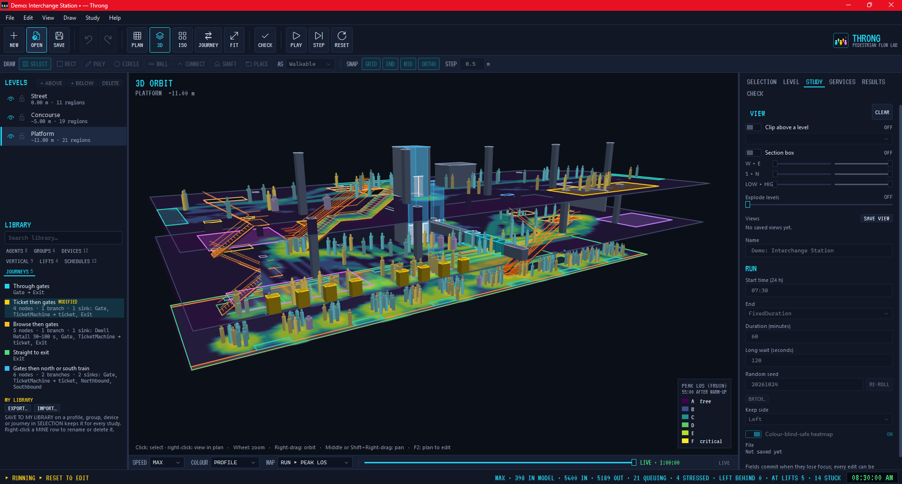
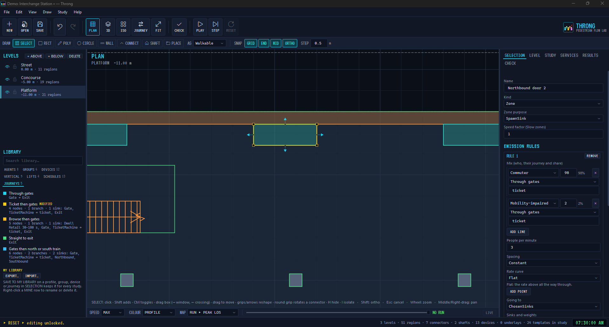

# Throng

**Conceptual pedestrian simulation for architects.** Sketch a space, drop in devices, press play, read the pressure.

<!-- TODO image: hero.png, a 3D ORBIT view of a busy study with a heatmap (about 1600×900) -->

Throng is a free Windows desktop app for testing circulation in early-stage designs: concourses, stations, lobbies,
stadium edges, venues. It favours fast setup and legible, "roughly right" crowd behaviour over scientific fidelity.

> Results are **indicative only** and are **not** compliance evidence.

## Features

- **3D-first, multi-level.** Draw floors in plan, stack levels at their true heights, and orbit the whole building in
  3D or isometric with clip planes, a section box and exploded levels.
- **Vertical circulation.** Stairs, ramps, escalators, travelators and lift banks, with queues, step-loading, landings
  and route choice that weighs crowding as people see it build up.
- **People.** Agent profiles (speed, size, patience, stair effort, accessibility needs), mix lines, and groups (families, friends,
  carers) who walk, queue and board together.
- **Journeys and devices.** Gates, ticket lines, kiosks, food, toilets and other service points, linked into journeys
  with branches, tags and dwell times.
- **Services.** Trains, planes, buses and rides on a timetable, with boarding and alighting flows.
- **Results.** Live and cumulative density heatmaps (Fruin Level of Service), zone, device and journey tables, graphs,
  CSV export, replay scrubbing, seeded batch runs, and a one-page **A3 PDF report**.
- **CHECK.** Rules that catch irrational studies before you run: unreachable sinks, under-sized stairs, missing
  services.
- **Library.** Built-in templates plus your own library of profiles, devices, groups and journeys, shared as
  `.thronglib` files.
- **Demos.** An interchange station and stadium sectors (up to about 30,000 seats) to explore straight away.

<!-- TODO image: plan-editing.png, PLAN (F2) with a selection, grips and the DRAW strip (about 1600×900) -->

## Download and install

1. Download **`Throng-Setup-<version>.exe`** from [Releases](https://github.com/aussieBIMguru/Throng/releases).
2. Run it. It installs for your user only, with no admin rights, and needs no separate .NET install.
3. Windows SmartScreen may warn that the setup is unrecognised, because it isn't code-signed yet. Choose
   **More info ▸ Run anyway**.

You need Windows 10 or 11 (64-bit) and a graphics card or driver with OpenGL 3.3.

Uninstalling (Settings ▸ Apps) keeps your library (`%AppData%\Throng`) and logs.

## Quick start

1. Start Throng and choose **File ▸ New from Demo** (Ctrl+Shift+D).
2. Press **PLAY**. Watch people arrive, queue and climb. Use **F3** for 3D and **F2** for plan.
3. Open **RESULTS** for tables and graphs. Use **MAP** to show density or Level of Service.
4. Export a **PDF report** from the File menu.

Then read **[Getting started](docs/getting-started.md)** to build your own study.

## Documentation

| Page | What's in it |
|---|---|
| [Getting started](docs/getting-started.md) | Install, the demo, and your first study from blank to results |
| [User guide](docs/user-guide.md) | Editing, vertical circulation, people, journeys, services, running, results, CHECK, reports |
| [Developing](docs/developing.md) | Building from source, tests, solution layout, releasing the installer |
| [Changelog](CHANGELOG.md) | What's in each version |

## Licence

Throng is [MIT](LICENSE) © 2026 Gavin Nicholls. Third-party components and their licences are listed in
[THIRD-PARTY-NOTICES.md](THIRD-PARTY-NOTICES.md). Both files ship next to `Throng.exe`.

Behaviour draws on published research, including Fruin's Level of Service, Helbing's social force model and
Weidmann's walking speeds. See the acknowledgements in the notices.
