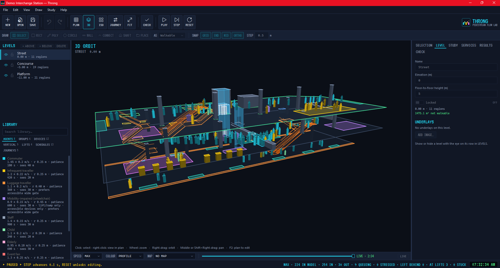
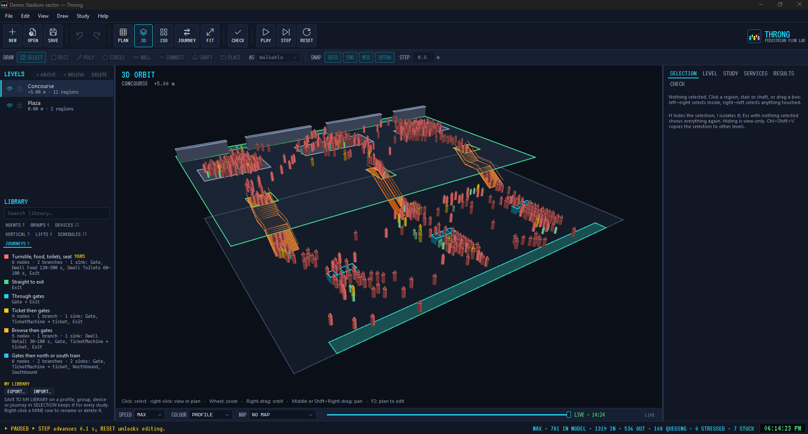
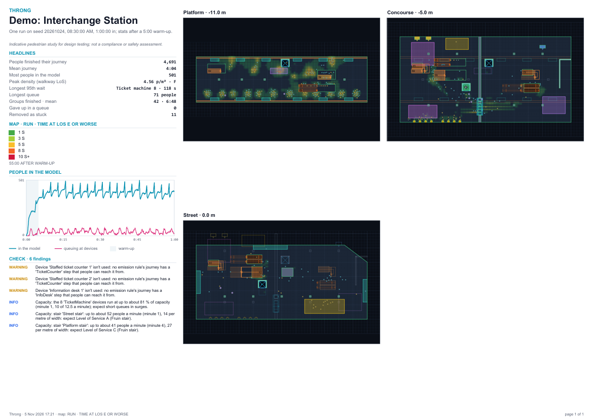

# Getting started

← [Back to README](../README.md) · [User guide](user-guide.md)

## 1. Install

Download `Throng-Setup-<version>.exe` from [Releases](https://github.com/aussieBIMguru/Throng/releases) and run it.
- It installs per user to `%LocalAppData%\Programs\Throng`, with no admin rights needed.
- It adds a Start menu shortcut, and a desktop shortcut if you tick it.
- `.throng` study files open in Throng on double-click.

The setup isn't code-signed yet. If SmartScreen warns, choose **More info ▸ Run anyway**.

## 2. Look around the demo

**File ▸ New from Demo** offers the *Interchange Station* and the stadium sectors. Open the station and press
**PLAY**.

<!-- TODO image: demo-running.png, the Interchange Station running in 3D, transport bar visible (about 1600×900) -->

- **F2** is plan, **F3** is 3D orbit and **F4** is isometric. Orbit with the mouse and zoom with the wheel.
- The **transport bar** under the viewport holds PLAY / PAUSE, STEP, RESET, **SPEED**, **COLOUR** (by profile, group,
  stress…) and **MAP** (density, Level of Service…).
- The **right panel** has tabs:
  - **SELECTION** shows what you clicked.
  - **STUDY** holds levels, the run, views and batch.
  - **SERVICES** holds timetables.
  - **RESULTS** holds tables and graphs.
  - **CHECK** lists warnings.
- Drag the replay slider to look back through the run, then press **LIVE** to return to now.

## 3. Your first study

1. **File ▸ New.** Set up levels in **STUDY ▸ LEVELS** (name and elevation).
   - Optionally, add a drawing underlay with **LEVEL ▸ ADD IMAGE…** and **SET SCALE**.
2. **Draw the floor.** In plan (F2), draw a **walkable** region with the Rectangle (`R`) or Polygon (`P`) tool.
   - Add **obstacles** and **walls** (`W`) for anything people can't walk through.
   - The green outline shows the net walkable area.
3. **Add spawns and sinks.** Draw **zones** and set them as spawn / sink in SELECTION.
   - On a spawn, add **EMISSION RULES**: who (a profile or group), how many per minute, and where they go.
4. **Go up and down.** Press `T` (CONNECT), pick a stair, escalator or ramp preset and the level above.
   - Click the bottom landing, aim up the run, and click again.
   - Use `O` for a lift shaft or void.
5. **Place devices.** Press `D` (PLACE) and pick a gate line, kiosk, toilet block and so on.
   - Link them into a **journey** if people should visit them on the way.
6. **CHECK** (`F7`) lists anything irrational, such as an unreachable sink or an undersized stair. Fix the errors.
7. **PLAY.** The first PLAY builds the navigation, and editing is locked until **RESET**.

<!-- TODO image: first-study.png, a simple two-level study in plan with a stair, spawn and sink (about 1600×900) -->

## 4. Read the results

- **RESULTS** has three drop-downs: **SOURCE** (last run or batch), **TABLE** (zones, devices, journeys, lifts…) and
  **GRAPH**.
- **MAP** colours the floor by density or **Fruin Level of Service** (A–F), live or accumulated over the run.
- **STUDY ▸ RUN ▸ BATCH…** runs several seeds in parallel and reports the mean with its min–max range.
- CSV export writes the tables (a folder per run for batches). **EXPORT PDF REPORT** makes a one-page A3 summary: headline numbers, every level in
  plan, the people graph and CHECK findings.

<!-- TODO image: pdf-report.png, a page of the exported A3 report (about 1600×1130) -->

## 5. Save and share

- **File ▸ Save** writes a `.throng` file, a single file with everything including underlays.
- Profiles, devices, groups and journeys you reuse can go into **your library** with **SAVE TO MY LIBRARY**.
  - Share them as a `.thronglib` from the LIBRARY tab.
  - A single profile can also go as a `.throngprofile`.

Next: the [User guide](user-guide.md).
