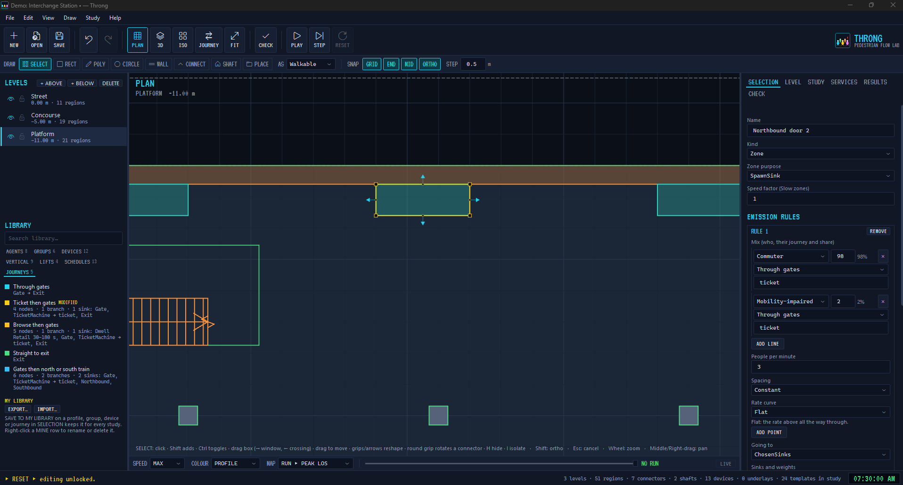
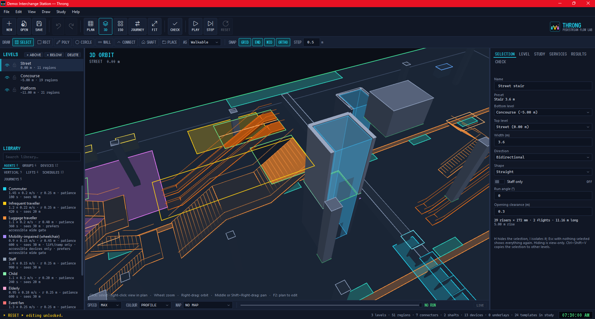
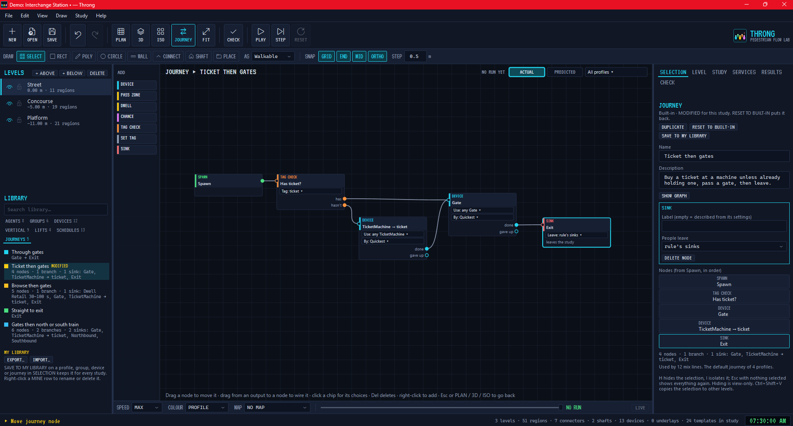
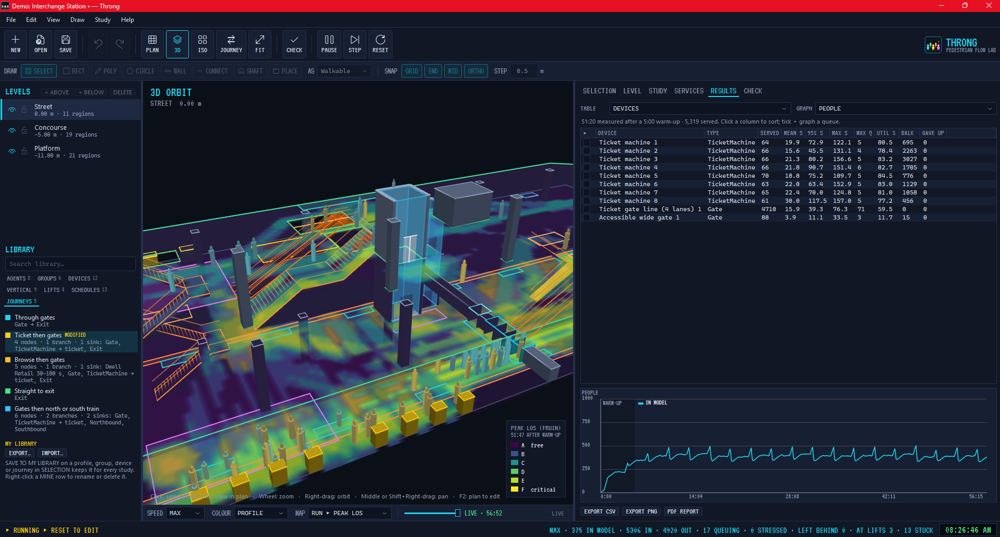

# User guide

← [Back to README](../README.md) · [Getting started](getting-started.md)

Throng is about **roughly right** crowd behaviour for design decisions. Results are indicative only and are not
compliance evidence.

**Contents:** [Editing](#editing-plan-view-f2) · [Vertical circulation](#vertical-circulation) ·
[People and groups](#people-and-groups) · [Devices and journeys](#devices-and-journeys) · [Services](#services) ·
[Views](#views) · [Running](#running) · [Results](#results) · [CHECK](#check) · [Library](#library) ·
[Files](#files) · [Where things are kept](#where-things-are-kept)

## Editing (plan view, F2)

<!-- TODO image: plan-editing.png (shared with the README) -->

| Key / action | What it does |
|---|---|
| `V` `R` `P` `C` `W` | Select, Rectangle, Polygon, Circle, Wall (or the DRAW strip under the toolbar) |
| `T` CONNECT | Stair, escalator or ramp: pick a preset and a level above on the DRAW strip (or double-click one in LIBRARY ▸ VERTICAL), click the bottom landing, aim up the run (15° steps, Shift free), click. `Tab` flips a switchback's return side; type an angle for an exact direction |
| `D` PLACE | Device or travelator: pick a preset on the DRAW strip (or double-click one in LIBRARY), click its position, aim the service side (travelator: click the far end), click |
| Spanning | Obstacles and walls: set Top level in SELECTION (default "This level only"), Height = Fixed or FullStorey, untick levels to skip them. Shafts: untick "Lift stops here" |
| Underlays | LEVEL tab ▸ ADD IMAGE…; SELECTION ▸ SET SCALE (click two points, type the distance); drag, rotate grip, opacity, lock |
| `O` SHAFT | Shaft / atrium / void: two corners or a drag. It spans every level until you set base and top in SELECTION |
| Round grip | On a selected connector: drag to rotate (15° steps, Shift free). Escalator pairs move, rotate and resize together |
| Click / drag (select) | Click picks; Shift adds, Ctrl toggles; drag left→right = window, right→left = crossing; drag a region to move it |
| Grips | Drag a vertex square; click or drag an edge-midpoint diamond to insert a vertex; Del removes the selected vertex |
| Edge arrows | Drag the arrow outside an edge to push/pull it; neighbouring edges keep their angle |
| `H` / `I` / Esc | Hide the selection / isolate it / show everything again (view-only, not saved) |
| Type a number while drawing | `x,y` first point · `w,h` rectangle · radius · length or `dx,dy` for polygon/wall segments; Enter applies |
| Enter / double-click | Finish a polygon or wall (clicking the first point also closes a polygon) |
| Backspace / Esc | Remove the last point / cancel (again to return to Select) |
| Shift | Force ortho while drawing or moving |
| Ctrl+C / X / V / D / A, Del | Copy, cut, paste in place (active level), duplicate (+1 grid step), select all, delete |
| Ctrl+Shift+V | Copy to Levels…: paste the selection in place on every ticked level, one undo step. Connectors and shafts keep their span |

Snaps: 0.5 m grid, endpoint, midpoint and ortho (toggle on the DRAW strip). Snap points come from the active
level and the level below. Locked levels can't be edited but still snap. The green outline is the net walkable
area (walkable union minus obstacles, walls, connector footprints and openings, and shafts).

Connectors draw as architectural symbols in plan: the lower level shows the part below mid-rise, the upper
level the part above, with treads, a belt line on escalators and an UP / DN arrow. In 3D they're true sloped
pieces. Each connector cuts its own opening in the upper level (0.3 m clearance, editable).

## Vertical circulation

<!-- TODO image: vertical.png, stairs, an escalator pair and a lift bank in 3D with people on them (about 1600×900) -->

- **Stairs and ramps** are free-flowing.
  - People use either side, keep to the study's side when there's counterflow, and pack into the ends when it's busy.
  - Capacity comes from the preset's flow per metre of width.
- **Escalators and travelators** step-load people at the comb (people per minute), run at belt speed, and let walkers
  overtake standers.
- **Lifts** are shafts with banks of cars, landing doors and dispatch.
  - People who need accessible routes, or who are lift-only, board first.
- **Route choice** weighs walking time, stair effort, each profile's liking for mechanised transport, and the waits it
  can see.
  - A big crowd is noticed from further away.
  - People peel off to a quieter stair or escalator once that's clearly quicker.
- **Staff only** (SELECTION) keeps the public off a connector.

## People and groups

- **Profiles** (LIBRARY ▸ AGENTS) set speed, size, patience, stair effort, sight, decisiveness, mechanised preference
  and accessibility needs.
  - Edit them in SELECTION.
  - Built-ins are edited as overrides, with RESET.
- **Groups** (LIBRARY ▸ GROUPS): Family, Couple, Friends, Wheelchair user + companion, School party, Fans, or your own.
  - Members are rows of a profile with a min–max count, and the top row leads.
  - Groups walk at the slowest member's pace, share every decision, queue together and wait for each other.
- **Emission rules** on a spawn zone set who arrives (profile or group), how many per minute, constant or Poisson
  arrivals, rate curves, and where they go (nearest sink, or chosen sinks by weight).
- **COLOUR ▸ GROUP** gives each group a hue. Hover over a person to see lines to their group mates.

## Devices and journeys

<!-- TODO image: journeys.png, the journey editor with branches and the journey overlay on plan (about 1600×900) -->

- **Devices** are service points such as gate lines, ticket machines, kiosks, food, toilets and security.
  - Each has lanes, a service time distribution, a queue type and a capacity.
- **Journeys** chain what people do: visit a device, dwell in a zone, branch by chance or tag, then leave.
  - Each profile or group has a default journey, and mix lines can pick another.
- People **balk** at long queues and **give up** after their patience runs out, as their profile sets.

## Services

The **SERVICES** tab holds timetabled services: **Train, Plane, Bus / coach, Ride, Other**.
- Each has a stopping area, arrival times or headways, a dwell, doors, and boarding and alighting numbers.
- The kind only changes the wording, the plan label and the starting timetable. They all run on the same engine.

## Views

| Key / control | What it does |
|---|---|
| `F2` PLAN · `F3` 3D · `F4` ISO | Plan (where you draw), perspective orbit, or orthographic 2:1 isometric of every visible level |
| `[` `]` (ISO) | Turn the iso view a quarter: SW, SE, NE, NW |
| STUDY ▸ VIEW | Clip above a level, a section box (six sliders, or drag its square handles in 3D), explode levels (0–30 m); 3D and ISO only, works while running |
| STUDY ▸ VIEW ▸ VIEWS | SAVE VIEW stores the mode, level, camera and cutaway in the study; GO restores it |
| `F7` CHECK | Every rule into the CHECK tab: click a row to go there, IGNORE what you've accepted |
| LIBRARY ▸ AGENTS | EXPORT… / IMPORT… a profile and its journeys as a `.throngprofile` |

People are drawn as flat discs when they're small on screen. Lift shafts have semi-transparent walls in 3D with the
landing doors left open.

## Running

| Control | What it does |
|---|---|
| PLAY / PAUSE | The first PLAY checks the study (errors block and are listed), builds the navigation and starts; editing is locked until RESET |
| STEP | Pause and advance one 0.1 s step (starts a paused run when none is active) |
| RESET | End the run, clear the agents and unlock editing |
| SPEED (transport bar) | ×½ to ×8 or MAX |
| SELECTION ▸ EMISSION RULES | On a spawn zone: profile, people per minute, constant or Poisson, nearest sink or weighted chosen sinks |
| STUDY ▸ RUN | Start time, end (fixed duration or until stopped), seed + RE-ROLL, keep side |
| Staff only | On a connector in SELECTION: public agents won't use it |
| Drag from LIBRARY | Drop a device on the plan to place it; drop a stair, escalator, ramp or travelator to start it at the drop point |

The status bar shows speed, agents walking, emitted, arrived, mean journey time and stuck agents (no progress for
30 s: a flashing ring; removed after 120 s; people queueing, being served or dwelling are never counted as stuck). Agents are capsules coloured by profile in 3D and discs in plan.

## Results

- **RESULTS ▸ SOURCE** switches between the last run and a batch (mean with min–max).
- **TABLE** covers zones, devices, journeys (including group rows), lifts and connectors. **GRAPH** shows people,
  flows and waits over time.
- **MAP** shows live density, Level of Service (Fruin A–F) and cumulative maps such as peak density, time above LoS D,
  and visits.
- **Replay.** Every PLAY records. Drag the transport-bar slider to look back, PLAY carries on from there, and LIVE
  jumps to now. **RESULTS ▸ REPLAY** re-runs one batch run on its seed.
- **Batch** (STUDY ▸ RUN ▸ BATCH…) runs N seeds headless in parallel.
- **Export**: CSV tables, and the **PDF report** (A3 landscape).
  - The report has headline numbers, every level in plan with the map you pick, the people graph and CHECK findings.
  - There are more pages past six levels.

<!-- TODO image: results.png, the RESULTS tab with a table and a graph beside a LoS map (about 1600×900) -->

## CHECK

**F7** runs every rule into the CHECK tab. It checks:
- reachability
- stair and device capacity against demand
- narrow gaps
- journey picks that match nothing
- timetables

Click a row to go to the problem. **IGNORE** findings you've accepted. Errors block PLAY; warnings don't.

## Library

- The **LIBRARY** tabs list the study's own items, then **MINE** (your library), then the built-ins.
- **SAVE TO MY LIBRARY** (SELECTION) keeps a profile, device, group or journey for every study.
  - Items marked **DIFFERS** can be updated from your library.
- **EXPORT** a ticked set as `.thronglib` to share it. **IMPORT** lets you keep both, skip or replace.

## Files

| Extension | What |
|---|---|
| `.throng` | A study: levels, regions, connectors, devices, journeys, services, settings and underlays in one file |
| `.thronglib` | A set of library items (profiles, devices, groups, journeys) |
| `.throngprofile` | One agent profile and its journeys |
| `.throngdevice` | One device definition |

Only `.throng` opens on double-click. Import the others from inside Throng.

## Where things are kept

| Where | What |
|---|---|
| `%LocalAppData%\Programs\Throng` | The app (replaced on upgrade) |
| `%AppData%\Throng\Library` | Your library (kept on uninstall) |
| `%LocalAppData%\Throng\Logs\throng.log` | Log file; attach it to bug reports |

Found a bug? Open an [issue](https://github.com/aussieBIMguru/Throng/issues) with the log, and the study if you can
share it.
